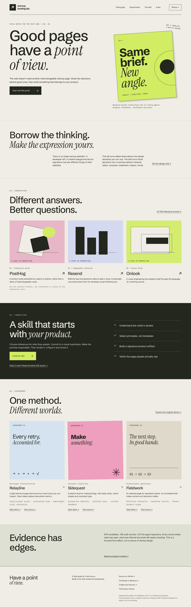
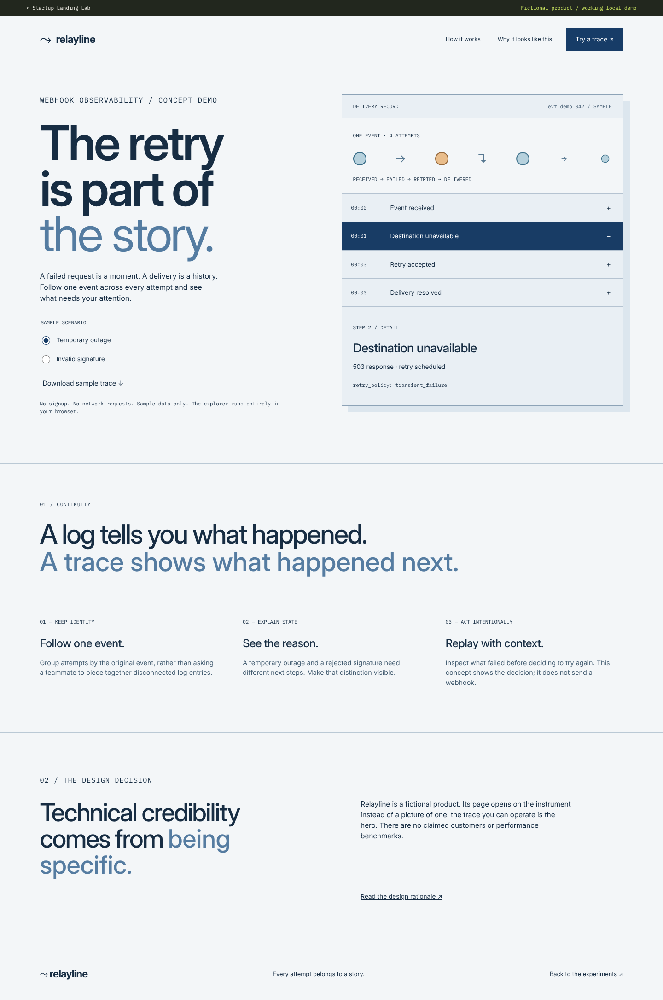
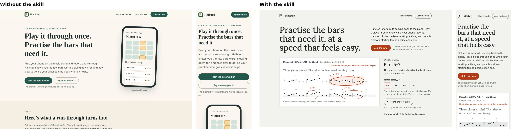

# Startup Landing Lab

**Great design skills already exist. This one takes the best rules from thirteen of them, adds what YC partners, operators and web research say a startup homepage must do, grounds it in dated measurements of real startup sites, and turns it into 111 checks built for one job: startup landing pages. It can build a page, change one part of it, or audit the one you already have.**

AI-built landing pages keep coming out the same: centred headline, framed screenshot, three adjective cards, a gradient blob. Version 0.5 makes every page commit to one ownable statement (a character with a job, an inhabited world, the product as a toy, the trade's own notation, monumental type), dealt from a catalogue so the first idea is not the habitual one, and then checks that a stranger still understands the page in five seconds. Good general design skills help, but none of them is about the specific decisions a startup homepage has to make. This skill takes the rules that hold up from the skills listed below, specialises them for landing pages, and grounds them in pages from YC, a16z speedrun and Pear companies that were opened, measured and dated.

[Explore the live field guide](https://tunakurucu.github.io/startup-landing-lab/) · [Install the skill](docs/installation.md) · [The 100 checks](skills/startup-landing-design/references/checklist.md) · [Read the research](research/README.md)



## Built on

Every rule here is rewritten in this project's own words and credited to where the idea appears. No text, rule names or code are copied; the licences and exactly what was taken are in [attribution](docs/attribution.md). None of these authors endorses this project.

| Skill | Author | Licence | What it contributed |
| --- | --- | --- | --- |
| [Impeccable](https://github.com/pbakaus/impeccable) | Paul Bakaus | Apache-2.0 | The idea of a deterministic anti-pattern detector: hidden-after-load text, flat hierarchy, tracking and headline limits, gradient text, glows, side stripes, overused faces, screenshot validity |
| [gstack](https://github.com/garrytan/gstack) (design-review, plan-design-review) | Garry Tan | MIT | Score the plan before building, first-impression test, 44px targets, AI-slop tells, a closed DONE / DONE_WITH_CONCERNS / BLOCKED status |
| [Emil Kowalski's skills](https://github.com/emilkowalski/skills) | Emil Kowalski | MIT | Motion mechanics: easing, stagger limits, no `scale(0)`, hover gating, `svh`, worst-case stress at 320px |
| [Web Interface Guidelines](https://github.com/vercel-labs/web-interface-guidelines) / [agent-skills](https://github.com/vercel-labs/agent-skills) | Vercel | MIT | Engineering hygiene: focus, labels, zoom, `transition: all`, image sizing, lazy loading, font loading, theme-color |
| [Matt Pocock's skills](https://github.com/mattpocock/skills) (grilling, handoff) | Matt Pocock | MIT | Ask few questions, each with a recommended default, and keep going when nobody answers |
| [Anthropic skills](https://github.com/anthropics/skills) (frontend-design, skill-creator) | Anthropic | Apache-2.0 | The list of current generated-design defaults; evals run with and without the skill |
| [Jakub Krehel's skills](https://github.com/jakubkrehel/skills) (better-typography, better-layout, variant) | Jakub Krehel | MIT | Type floors (no light weights at small sizes, unitless line-height, `text-wrap`, tabular figures), grouping by space, hero variants that differ on one named axis |
| [Meng To's skills](https://github.com/MengTo/skills) (no-ai-design-slop, audit-reference-originality) | Meng To | MIT | The removal pass (every decorative element names its job or goes) and a category-by-category originality check against references |
| [marketingskills](https://github.com/coreyhaines31/marketingskills) (copywriting, product-marketing) | Corey Haines | MIT | A line-by-line copy gate, structural tells of generated copy, and a title that leads with category for an unknown brand |
| [taste-skill](https://github.com/Leonxlnx/taste-skill) (critique) | Leonxlnx | MIT | Scores capped by measured failures, and a fixed order for fixes |
| [auteur](https://github.com/agiwhitelist/auteur) | agiwhitelist | MIT | Name the category default and the obvious anti-default and avoid both; compare against your own past builds |
| [ui-skills](https://github.com/ibelick/ui-skills) (fixing-metadata) | Julien Thibeaut | MIT | The share-card and metadata contract |
| [wondelai skills](https://github.com/wondelai/skills) (obviously-awesome) | Wondel.ai | MIT | Positioning inputs before the promise, after April Dunford |

Beyond skills, the copy, structure and audit rules draw on Paul Graham and Y Combinator's partners, April Dunford, Julian Shapiro, Harry Dry, Copyhackers, Jason Cohen, Patrick McKenzie, Peep Laja, Nielsen Norman Group, WCAG 2.2, web.dev and peer-reviewed research on first impressions and credibility, and the craft rules draw on design-engineering writing from Linear, Vercel, Stripe, GitHub, Figma and Granola and practitioners such as Rauno Freiberg, Sara Soueidan and Ryan Mulligan. Each reference file lists its sources.

What this project adds: a dated casebook of real startup homepages with measured type, layout and motion; seven archetype recipes; a decision record that maps each visitor doubt to a product artifact; two hero variants scored before any code; and a script that refuses to call the page done until all 111 checks are answered.

## The 111 checks

| Group | Checks | Examples |
| --- | --- | --- |
| Product and story | 9 | A stranger can say what it does in five seconds; each visitor doubt has an artifact |
| Copy and positioning | 13 | Headline beats the visitor's current alternative; no generic marketing phrases; no builder notes on the page; dates agree with their weekdays |
| Hero | 7 | Headline, action and the signature artifact in the first screen at 1440 and 390; the button names its outcome; no false floor |
| Structure and conversion | 6 | Cost is findable; no covering pop-ups; short forms; install command and docs for developer tools |
| Type | 11 | Hierarchy ratio, tracking floor, 12px minimum, measure, overused faces, no silent fallback to a default face |
| Layout | 8 | No overflow at 390 or 320, even after a 200-character paste; no clipped text, no nested cards |
| Colour | 4 | WCAG AA contrast, no gradient text or glows, a ground chosen for the product |
| Template tells | 6 | No adjective card rows or icon tiles; the logo-swap test; nothing copied from references |
| Motion | 8 | Reduced motion removes movement and hides nothing; nothing moves by itself without a pause |
| Mobile and input | 10 | Every artifact control answers in view on a phone, 44px artifact targets, Escape closes the menu, eight screens at most |
| Accessibility | 13 | Names, alt, a focus ring with real contrast, focus never dropped to the body, a visible skip link, text spacing survives |
| Performance and metadata | 7 | Hero never lazy-loaded, layout shift, lab LCP, title, description and share card |
| Honesty and proof | 5 | No unsupplied logos or testimonials, no unsourced numbers, no fake urgency |
| Process | 4 | Screenshots opened, one structural revision, `verify-record` passes |

79 are checked automatically by [`check-page.mjs`](skills/startup-landing-design/scripts/check-page.mjs). The other 32 need eyes, so the agent answers them in its decision record, and [`verify-record.mjs`](skills/startup-landing-design/scripts/verify-record.mjs) will not let it finish while any are open. This site runs the same automatic checks on every page in CI.

## Audit your own homepage

Point an agent with the skill at your site and ask for an audit. It reads your repo and docs first, renders the page at three widths, runs the automatic checks, and answers the [audit lens](skills/startup-landing-design/references/audit-lens.md): the questions YC partners, operators and web research say a startup homepage has to answer. You get `AUDIT.md`: findings ordered by harm, each phrased as "if you change X, visitors can Y, because Z", the three changes that matter most, and what to keep. It changes nothing on your site.

> Use startup-landing-design to audit our homepage at https://example.com. We are pre-launch and selling to small finance teams.

## Install

```bash
npx skills add tunakurucu/startup-landing-lab
```

That installs the skill for the agent you pick. To render and check pages, the skill's scripts need Playwright: `npm i --prefix /tmp/sld-deps playwright @axe-core/playwright && npx --prefix /tmp/sld-deps playwright install chromium`, then run them with `SLD_DEPS=/tmp/sld-deps`.

Or copy the folder by hand. You do not need the gallery.

```bash
git clone https://github.com/tunakurucu/startup-landing-lab.git
mkdir -p .agents/skills
cp -R startup-landing-lab/skills/startup-landing-design .agents/skills/
```

Codex and Cursor document `.agents/skills/`. Claude Code uses `.claude/skills/`. See [project and user-level instructions](docs/installation.md) and their official sources. Client discovery paths are documented; end-to-end runs in all clients are not claimed.

## Use it

> Use startup-landing-design to build a landing page for my developer API. Choose an appropriate visual direction, make the product understandable through an original local demo, then inspect and refine the mobile layout.

The workflow: understand the product → select reference principles → compare two hero structures and pass a pre-build gate → build from the archetype's recipe → render at three widths and run the checker → critique → make at least one structural revision → verify the record. The agent leaves a filled `DESIGN-RECORD.md` beside the page.

[Read the skill](skills/startup-landing-design/SKILL.md) or try [consumer and B2B prompts](docs/installation.md).

## Three original experiments

| Demo | Direction | Working behavior |
| --- | --- | --- |
| Demo | Direction | Type | Working behavior |
| --- | --- | --- | --- |
| [Relayline](https://tunakurucu.github.io/startup-landing-lab/#/demo/relayline) | Technical instrument: the working trace *is* the hero | Inter, IBM Plex Mono | Switch failure scenarios, inspect each attempt, export sample JSON |
| [Sidequest](https://tunakurucu.github.io/startup-landing-lab/#/demo/sidequest) | Playful creative ritual | Bricolage Grotesque, Instrument Serif italic | Deal an original three-part brief; keep it as a text file |
| [Fieldwork](https://tunakurucu.github.io/startup-landing-lab/#/demo/ledger) | Editorial operations | Instrument Serif, IBM Plex Sans | Compare structured and informal handoffs; export the working brief |

All three pass the skill's automatic checks with no block failures (a few warnings are kept on purpose, each with its reason), use self-hosted open-licence type, and carry motion written as contracts — trigger, purpose, fallback, duration — that reduced-motion removes without hiding anything. Fictional brands, original code and copy, no fabricated customers, figures or testimonials. [Design decisions, motion contracts and an honest diversity review](docs/demo-decisions.md).



## Research you can inspect

678 candidate websites, 602 of them from YC (W25–F26), a16z speedrun (SR001–SR007), a16z, Pear, Sequoia Arc, Neo and EF, each verified on the program's own page, plus a reference tier of 42 product companies chosen for their design. 135 audit records: 115 rendered at desktop and phone width, operated, reloaded with reduced motion and measured (October 19–20, 2026); 20 earlier desktop inspections. 597 homepages carry computed-style measurements, and the recipes quote them. One finding to start with: 441 of 597 measured homepages had animations running at load, and 106 had no reduced-motion rule at all. [Findings, method and limits](research/README.md) · [Measurements](research/measurements.md).

Tablet layouts and real-device behaviour remain unverified. This is a dated sample, not a ranking or a census. [Method, evidence and limitations](research/README.md).

The gallery uses original abstract composition studies and links to source websites. It does not redistribute third-party screenshots or assets.

## Does the skill work?

Tested blind. Fresh agents built the same product brief twice, once with the skill and once without, and a separate grader saw only "page A" and "page B", operated both at desktop and phone width, and scored eight criteria.

| Round | Briefs | Skill page preferred | Total score (with / without) |
| --- | --- | --- | --- |
| 1 (v0.3.0) | 3 | 2 of 3 | 182 / 180 |
| 2 (after fixing what lost round 1) | 3 + 1 new holdout brief | 4 of 4 | 254 / 235 |
| 3 (v0.4, pre-registered, 12 new briefs, 3 graders each, hard fails adjudicated) | 12 | won 7, tied 4, lost 1 (p = 0.07, not significant) | 2,781 / 2,436 summed over three graders |
| 4 (v0.5 with statements, pre-registered, 4 new briefs, 3 graders each) | 4 | won 4 of 4 (p = 0.125; four briefs cannot be significant) | 950 / 781 summed over three graders |
| 5 (v0.6, artifact operated on a phone, pre-registered, 4 new briefs) | 4 | won 4 of 4, 12 of 12 grader runs; mean 83.0 / 100, target 87 not met | 996 / 836 summed over three graders |

The gains are in distinctiveness (+9 across four briefs), fit to the brief, product proof and honesty (+4 each). The skill's pages were slightly less clear at first glance (−2) and their interactions slightly weaker (−2). Round 1's loss, a developer-tool page with no install command, is kept in the record along with the rule change that caused it.



Round 3 was larger and stricter: pre-registered, twelve briefs nobody had seen, three graders per pair from a different model than the builders, and every flagged hard fail re-checked blind. The skill page won 7, tied 4 and lost 1; the sign test gives p = 0.07, short of the pre-registered 0.05, so an effect is not shown at this size. Each grader persona preferred the skill page in 11 of 12 pairs. Both arms shipped hard fails, mostly a main button that went to an invented email address; v0.5 forbids that and tests phone layouts at 3× pixel density. Round 4 tested v0.5, with the statement layer, on four more new briefs: the skill page won all four, every grader preferred it, and no skill page had a confirmed hard fail; four briefs are too few for significance. Round 5 tested v0.6, which operates the artifact on a phone, on four more briefs: the skill page won all 12 grader runs with a mean of 83 of 100 against 70, short of the 87 it was aiming for; two pairs were rebuilt on a different builder model partway through, which the report breaks out. In round 5 the two rebuilt pairs were built by the same model family as the graders, so those two are not a cross-family test. [Full round 3, 4 and 5 reports](evals/run.md).

Limits for rounds 1–2: seven pairs are not a benchmark, builders and graders were AI agents from the same model family, every verdict was medium confidence, and three of round 2's four briefs were the ones the fixes were made against. The pages, grades and A/B keys are all in [`evals/`](evals/run.md), so you can judge them yourself.

## Run and validate

Node 22.12+ or 24 and Python 3.12+:

```bash
npm ci
python3 -m pip install -r requirements.txt
npm run dev
```

```bash
npm run validate
agentskills validate skills/startup-landing-design
npm run build
npm run lint
npm test
npx playwright install chromium
npm run test:browser
```

The browser suite covers every route at 1440/768/390 with axe, the skill's 79 automatic checks on nine routes, each motion contract with and without reduced motion, 320 px stress, filters, navigation, demo controls and downloads. See [the evaluation](docs/evaluation.md) for what actually ran and what did not. [Architecture](docs/architecture.md) explains the single-source data flow and hash routing for Pages.

## Help improve it

Submit a real website with company/source verification, inspection date and viewport, specific design observations, transferable insights, and honest limitations. Corrections and deeper mobile audits are particularly useful. Start with [CONTRIBUTING.md](CONTRIBUTING.md) and [the audit template](research/audit-template.md).

Original code and authored material are [MIT licensed](LICENSE). Referenced websites and trademarks remain their owners' property. No affiliation with or endorsement by Y Combinator or featured companies. [Attribution](docs/attribution.md).
