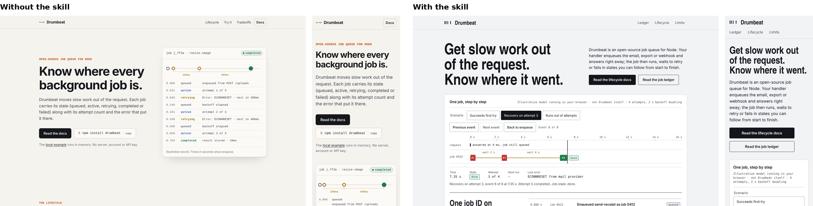

# Skill evaluations

Give an agent **only** the standalone `skills/startup-landing-design/` directory and one raw brief from `briefs/`. Put each output in an empty separate folder. Do not show the agent the assertion list, demo code, expected archetype or another run's output. Ask it to finish the page and `DESIGN-RECORD.md`, then score against [assertions.json](assertions.json).

Run `node skills/startup-landing-design/scripts/check-page.mjs <url-or-html>` where Playwright is installed and save its JSON. Use `scripts/render.sh` for 1440/768/390 screenshots; inspect hero, middle and footer, and check the saved record's pre/post gates and actual structural revision. Repeat a brief with the same agent/environment to see whether results vary. For an external client, first install only the skill folder; log its model, version, date and output path. A source-only code check is not a rendered pass.

| Brief | Agent / environment | Date | Passed | Notes |
| --- | --- | --- | --- | --- |
| queue | Sandboxed agent, standalone skill folder and brief only | 2026-10-19 | 2/7 | Archetype chosen and two hero variants compared; pre-build gate passed. Post-gate, render and revision sections left pending. Checker fails `type_system`, `reduced_motion_rule`, `valid_links`; no screenshots. |
| gift | Sandboxed agent, standalone skill folder and brief only | 2026-10-19 | 2/7 | Archetype chosen and two hero variants compared; pre-build gate passed. Post-gate, render and revision pending. Checker fails `type_system`; no screenshots. |
| renewal | Sandboxed agent, standalone skill folder and brief only | 2026-10-19 | 1/7 | HTML page only; checker passes all seven checks, but no `DESIGN-RECORD.md` and no screenshots. Other assertions fail or cannot be established. |

These are first-run outputs, not complete eval passes. The three runs were isolated from the demo source and the assertion file. The cross-run archetype distinction is **unverified**, since the renewal run produced no decision record. Local control behavior and a structural revision were not manually verified. Output folders were kept outside the repository; this table preserves the observed results. The checker command was `node skills/startup-landing-design/scripts/check-page.mjs <output>/index.html`. No run inside a supported client (Claude Code, Codex, Cursor) has been performed yet.

The pattern across all three runs is the same: the agent does the interpretation and selection steps and stops before rendering and revision. That is a skill weakness, not only an environment limit, and it is the first thing to fix in v0.3.

## v0.3: first with/without comparison

[Full report and outputs](runs/2026-10-19-queue/REPORT.md). Brief: queue. Skill at commit `efdeb7a`. An independent agent in a separate environment built the page twice, once following the skill and once without it, then graded both against `assertions.json`, which it opened only after both runs.

| Assertion | With skill | Without skill |
| --- | --- | --- |
| verify-record exits 0 | fail: exited 0 as DONE_WITH_CONCERNS with no screenshots or checker JSON, which the assertion does not accept | fail: no record |
| Archetype and two scored hero variants before code | pass | fail |
| Pre-build gate recorded | pass | fail |
| Post-render gate recorded | fail: source only | fail |
| check-page JSON has no failures | can't establish: browser never launched | can't establish |
| Screenshots at 1440, 768, 390 | fail: browser download failed | fail |
| Structural revision with before/after | pass (source evidence) | fail |
| No fabricated proof | pass | pass |

Neither page could be rendered: the environment could not download a browser, and the skill's scripts crashed instead of reporting that. So the run shows a clearer decision trail and a more deliberate artifact with the skill, and says nothing yet about visual quality. Three assertions about cross-brief behaviour need the other two briefs.

The evaluator listed 28 places where the instructions were unclear or overclaimed. Fixed in response:

- `browser.mjs` finds Playwright from `SLD_DEPS`, the working directory or the skill folder, and falls back to a system Chrome. `check-page.mjs` and `render.sh` now exit 3 with `"status": "unavailable"` and the exact error instead of crashing with empty output; `verify-record` refuses DONE when that happens.
- The completion contract no longer overclaims: exit 0 means the record is complete and honest; only `OK DONE` means rendered and checked.
- Checklist verdicts gain `unverified`, which rules out DONE.
- `verify-record` reads each PNG's width from its header and rejects a screenshot that does not match its row, instead of trusting file size.
- Both render backends write the same files (`<width>-top.png`, `<width>.png`).
- The hero table has one column per score, and the scores must be numbers.
- Motion tables no longer fade text that must be read; "desktop-only" evidence labels, the "short" record, the effort budget, the backend boundary, "revise once" and "offline" were reworded.

Still open from the report: dating an interaction and its measurement separately in each casebook entry, and a way to mark the primary action explicitly.

## v0.3: blind A/B, round 1 (2026-10-19, skill at `ec80c9c`)

Six fresh agents built the three briefs, each once with the skill and once without (same model, same rules: one static page, no network, no invented proof). A separate grader per brief saw only the two pages labelled A and B, the brief, and screenshots at 1440, 768 and 390, operated both pages, and scored eight criteria from 1 to 10. Outputs, grades and the A/B key: [runs/2026-10-19-ab-round1](runs/2026-10-19-ab-round1/).

| Brief | Preferred (blind) | With skill /80 | Without /80 | Confidence |
| --- | --- | --- | --- | --- |
| gift (Poolday) | with skill | 66 | 60 | medium |
| renewal (Ledgerlight) | with skill | 61 | 59 | medium |
| queue (Drumbeat) | without skill | 55 | 61 | medium |

What the skill did better: product shown working in the first screen, every illustrative element labelled, and three pages that look like three different companies. The three no-skill pages share one template (cream ground, small coloured caps label, headline left, card right, two buttons). On the skill's own 64 automatic checks the skill pages had no failures and the no-skill pages had two to five block failures each; those checks are the skill's, so that comparison is not neutral.

Where it lost, and why:
- **Queue:** no install command and no code at all, and a "docs" button that scrolled the page. The cause was a rule added earlier the same day ("show a labelled local model rather than inventing integration code").
- **Disclaimer sections** ("What's not decided yet", "What we can show, and what we can't") read to graders as internal notes pasted onto a homepage.
- **Craft** scored lower in two of three: dead space in the first screen, a label clipped in one interactive state.

Fixed before round 2: complete the conversion path (install command and an example marked `illustrative API` when the real API is unknown; no button that claims a destination it does not reach); honesty beside the claim, never a section about what the company lacks; operate and screenshot the signature artifact in every state; phones recompose the artifact rather than remove it.

## v0.3: blind A/B, round 2 (2026-10-19, skill at `b94f92d`)

The three with-skill pages were rebuilt with the fixed skill and compared against the same round-1 no-skill pages, plus a fourth brief neither side had seen ([practice](briefs/practice.md), built both ways). New A/B order, new graders, same rubric. Outputs, grades and key: [runs/2026-10-19-ab-round2](runs/2026-10-19-ab-round2/) (in `mapping.json`, `with2` is the rebuilt skill page).

| Brief | Preferred (blind) | With skill /80 | Without /80 | Confidence |
| --- | --- | --- | --- | --- |
| queue (Drumbeat) | with skill | 63 | 61 | medium |
| gift (Poolday) | with skill | 64 | 60 | medium |
| renewal (Ledgerlight) | with skill | 65 | 57 | medium |
| practice (Halfstep, holdout) | with skill | 62 | 57 | medium |

By criterion, summed over four briefs (with / without): clarity 32/34, fit 33/29, distinctiveness 32/23, proof 33/29, craft 30/29, mobile 30/29, honesty 33/29, interaction 31/33.

The same no-skill pages scored within two points of their round-1 scores under different graders (queue 61 and 61, gift 60 and 60, renewal 59 and 57), which suggests the graders are reasonably consistent.

Graders' remaining complaints about the skill pages: an "illustrative API, confirm names" label that made a developer tool look unsure of itself; a heading font that failed to load when the page was opened from disk; a truncated form label; heavy dark sections on a celebratory page. Fixed after this round, not yet re-tested: the example label is stated once and the names to confirm go in the record, and the checker now runs all 64 checks on pages opened from disk, so builders no longer move to a local server, which is how the font failure went unnoticed.

Limits: n = 4 pairs; builders and graders are agents from one model family; three of the four briefs were the ones the fixes targeted.

To add a client row: install only the skill folder into a fresh project in that client, run one brief with the skill and once without it, and preserve prompts, pages, records, rendered screenshots and graded assertions. Compare product fit and output diversity as well as the mechanical checks. Three trials cannot establish a general performance claim.

## v0.4: blind A/B, round 3 (2026-10-20, skill at `1bd8387`)

Pre-registered before the first build: [PREREG.md](runs/2026-10-20-ab-round3/PREREG.md). Twelve new briefs (ten new pages, one redesign of an existing site, one change to a Next.js 16 app), each built once with the skill and once without (k = 1, seed 593854993). Builders: fresh agents, model `claude-fable-5-1`. Graders and adjudicators: fresh agents, model `claude-opus-5-5`, three per packet playing a designer, a buyer and an engineer, each scoring ten criteria and operating both pages at 1440, 768 and 390. Flagged hard fails were checked by a separate blind adjudicator who saw one page only. Everything is in [runs/2026-10-20-ab-round3](runs/2026-10-20-ab-round3/): builds with transcripts, packets, grades, adjudications, the sealed key and the tally.

**Reliability first.** All 4 retest packets (pairs re-graded with A and B swapped by new graders) got the same verdict. No same-arm packets were run at k = 1.

| Brief (kind) | Pair | Verdict (skill page) | Why | Votes for skill page | S with | S without | Δ | Hard fails with / without |
| --- | --- | --- | --- | --- | --- | --- | --- | --- |
| agenda (new page) | agenda-r1 | win | other page hard-failed | 3/3 | 224 | 185 | +39 | - / HF1,HF2 |
| alerts (new page) | alerts-r1 | win | majority preference and summed score agree | 3/3 | 241 | 208 | +33 | - / - |
| brewday (Next.js) | brewday-r1 | win | other page hard-failed | 3/3 | 231 | 195 | +36 | - / HF1 |
| cancellations (new page) | cancellations-r1 | tie | both hard-failed | 2/3 | 224 | 219 | +5 | HF1 / HF2 |
| envvars (new page) | envvars-r1 | win | majority preference and summed score agree | 3/3 | 236 | 209 | +27 | - / - |
| handover (redesign) | handover-r1 | win | majority preference and summed score agree | 3/3 | 239 | 219 | +20 | - / - |
| heater (new page) | heater-r1 | win | majority preference and summed score agree | 3/3 | 232 | 217 | +15 | - / - |
| kitchens (new page) | kitchens-r1 | tie | both hard-failed | 3/3 | 231 | 182 | +49 | HF1 / HF1 |
| nightly (new page) | nightly-r1 | loss | this page hard-failed | 1/3 | 214 | 215 | -1 | HF1 / - |
| questionnaire (new page) | questionnaire-r1 | win | other page hard-failed | 3/3 | 246 | 197 | +49 | - / HF2 |
| stitch (new page) | stitch-r1 | tie | both hard-failed | 3/3 | 227 | 196 | +31 | HF3 / HF1 |
| sunrise (new page) | sunrise-r1 | tie | both hard-failed | 3/3 | 236 | 194 | +42 | HF1 / HF1 |

**Primary result.** The skill page won 7, tied 4 and lost 1 of 12 briefs (exact two-sided sign test on 8 untied briefs, p = 0.0703). Counting ties as losses, p = 0.7744. The result is the same at tie bands 0 and 12. This does not reach the pre-registered 0.05 threshold: an effect is not detected at this sample size, which is different from no effect. All four ties are briefs where both pages had a confirmed hard fail; the one loss is a brief where only the skill page hard-failed.

**Descriptive only (no p-values).** Across the 36 primary-packet gradings, each persona preferred the skill page in 11 of 12 packets.

| Persona | Prefers skill page | Prefers other | Mean /100 with | Mean /100 without | Mean /80 (round 1-2 criteria) with | without |
| --- | --- | --- | --- | --- | --- | --- |
| designer | 11 | 1 | 78.33 | 68.5 | 62.5 | 54.25 |
| buyer | 11 | 1 | 77.58 | 68.25 | 61.83 | 54.33 |
| engineer | 11 | 1 | 75.83 | 66.25 | 60.17 | 52.25 |

Mean per-criterion difference, skill minus no skill, all personas: clarity +0.86, fit +1.14, distinctiveness +0.33, proof +1.31, craft +0.5, mobile +0.94, honesty +1.81, interaction +1.0, copy +0.28, first_screen +1.42 (each criterion 1–10). Clarity and interaction, the two criteria the skill lost in round 2, were positive here.

**Hard fails** (confirmed by the adjudicator; a hard fail attaches to the build):

| Arm | HF1 broken primary action | HF2 fabricated proof | HF3 unreadable mobile |
| --- | --- | --- | --- |
| With skill | 4 | 0 | 1 |
| Without | 5 | 3 | 0 |

- kitchens, with: the maker form opens an email to an address the brief never gave.
- kitchens, without: the maker form says "Noted. We'll email you…" but only opens a mail draft to an invented address.
- cancellations, with: "Book a 15-minute setup call" scrolls to a panel whose button does nothing; the calendar link was missing and the page said so only beside the dead button.
- cancellations, without: "Most clinics pick between five and fifteen minutes", a usage claim the brief does not support.
- nightly, with: "Request a TestFlight invite" opens an email to an invented address.
- sunrise, with: "Reserve a Morrow" opens an email to an invented address.
- sunrise, without: "Hold my place" says "Your place is held" but sends nothing.
- stitch, with: a canvas sized from the device pixel ratio widens the phone page to 539 px at a 3× screen; at 1× it is fine.
- stitch, without: "Open the beta editor" scrolls to the demo instead of reaching an editor.
- brewday, without: "Request early access" opens an email to an invented address.
- agenda, without: the sign-up opens an email to an invented address, and an invented city, agenda and volunteers are presented as real.
- questionnaire, without: "approved in one pass instead of three", a saving the brief says does not exist.
- Rejected by the adjudicator: agenda with (a form that states "Not sent yet" after submitting is not a broken action), brewday with (same), nightly without (the flagged mail link was a secondary link).

**What the skill still got wrong.** Four of its five hard fails share one cause: when the brief gave no destination for the main action, the skill's rule "point to the closest real thing" led builders to invent an email address on an example domain, or to scroll to a dead panel. The fifth was a canvas bug that only shows on dense phone screens, which the skill's own overflow check did not test. Both are fixed in v0.5 (below).

**Cost.** Skill builds took a median 21 minutes (16–25) and about 69,000 output tokens, with a median 70 tool calls; no-skill builds took a median 9 minutes (6–13), about 35,000 output tokens and 27 tool calls. All 12 skill builds read `SKILL.md`. 11 of 12 no-skill builds loaded the client's built-in frontend-design skill, so the control is "the client as shipped", not "no design guidance".

**Deviations**, in full from [DEVIATIONS.md](runs/2026-10-20-ab-round3/DEVIATIONS.md):

- 2026-10-20 04:10 UTC. Isolation breach in the no-skill arm. The build prompt named the repository's `node_modules` as the Playwright path; two no-skill builders browsed upward from it. W005 (envvars/without) read the skill and used it (its folder contains DESIGN-RECORD.md and check.json); W001 (kitchens/without) listed the skill folder in a `find` but did not read any skill file. Both builds are invalid under protocol step 3 (visible skills must match the arm) and are rebuilt. Fix: Playwright and axe were copied to `/home/claude/r3/deps/` outside the repository, and every later prompt uses that path; the skill arm's SLD_DEPS points there too. The invalid outputs are kept outside the run folder and are not graded. Builds W002, W003, W004 and W007 were checked: no skill path appears in their transcripts.
- 2026-10-20 05:20 UTC. Start markers. Two builders deleted the operator's `.start` file in their working folder while tidying: W008 (agenda/without) and W015 (questionnaire/with). Their start times in `meta.json` are taken from the first message timestamp of the build transcript instead (within a minute of the launch); wall-clock seconds for those two are approximate.
- 2026-10-20 05:20 UTC. Both arms ran in a client whose built-in skills were visible to the agent. Six of the seven no-skill builds finished so far invoked the client's built-in `frontend-design` skill; no skill-arm build did (they used the installed skill). This is recorded per build in `meta.json` (`harness_skills_invoked`) and reported in the summary: the control arm is "the client as shipped", not "no guidance at all".

## Blinding scrub notes (step 6)

- P016 side B: "DESIGN-RECORD" remains in README.md outside a comment (visible text or identifier); left in place
- 2026-10-20 06:05 UTC. Grading started before the last two builds (W023 kitchens/with, W024 cancellations/with) finished, so packets P001 and P005 did not exist yet. Jobs in `grade_queue.json` are run in queue order except that the six jobs on P001 and P005 are deferred until those packets are assembled, then run in their queue order. Graders never see more than one packet, so the order change cannot leak information between packets.
- 2026-10-20 06:05 UTC. Packet cleaning (step 6.1) also removed builder tooling folders (`tools/`, `tests/`, `shots-v1/`) that the page never references, and dropped README lines that named removed process files (logged in `scrub-<side>.diff` for P016 side B). brewday sides were built in a hard-linked copy of the round's install outside the repository because Turbopack refuses a `node_modules` symlink that resolves outside its root; the build logs say so.
- 2026-10-20 14:30 UTC. Adjudication (step 8). Each flagged side was copied to its own folder outside the repository with only that page, its probe output and screenshots, the brief, the hard-fail table and the flags (18 sides). The protocol's adjudicator prompt was extended with environment notes (where Playwright is, where to keep scratch files) and one instruction: check a phone-layout flag at a device scale factor of 3 as well as 1, because one grader found an overflow that appears only on dense screens. The same build can appear in two packets (retests); each packet side is adjudicated separately, and a confirmation in either attaches to the build, as the protocol says.

**Limits.** Agent graders playing a designer, a buyer and an engineer, not people; builders and graders are from one model family. Not a conversion result. Twelve fictional briefs, one model, one client version, one skill commit. The operator who assembled packets had also read the build summaries, so the analyst was not blind to which page was which before unblinding, although grading and adjudication were. These twelve briefs informed the v0.5 changes, so they are no longer unseen; round 4 uses new briefs.
